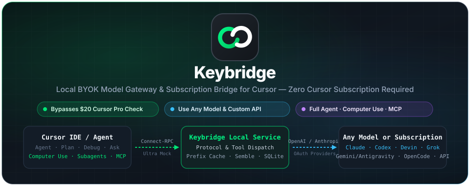
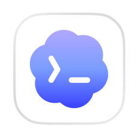

<div align="center">



# Keybridge

**Run Cursor Agent at full power with any model or subscription — without paying for the $20/mo Cursor Pro plan.**

[](./LICENSE)
[](#quick-start)
[](#architecture)
[](#architecture)

[Why Keybridge](#-why-keybridge) · [Supported Subscriptions](#-supported-subscriptions--byok-channels) · [Supported Cursor Features](#-full-cursor-feature-support) · [How It Works](#-how-it-works) · [Quick Start](#-quick-start)

</div>

---

## Why Keybridge

Cursor locks its best Agent features behind a **$20/month Pro subscription** (or $200/month Ultra) and restricts which models can drive its native tool runtime.

**Keybridge** runs a local gateway on your machine that speaks Cursor's native `aiserver.v1` Connect-RPC / Protobuf protocol end to end:

- **Bypasses the $20 Cursor Subscription Check:** Emulates an active local **Cursor Ultra** account (`membershipType: "ultra"`, `$200` included plan quota, zero slow-pool throttling) so Cursor unlocks every gated Agent capability out of the box — even on a free or unauthenticated Cursor install.
- **Use Any Model You Want:** Connect any **OpenAI-compatible** (`/v1/chat/completions` or `/v1/responses`), **Anthropic-compatible** (`/v1/messages`), local (**Ollama, vLLM, LM Studio, llama.cpp**), or custom API endpoint with full control over model IDs, headers, reasoning effort, thinking budgets, and parameters.
- **Reuse Your Existing AI Subscriptions:** Sign in directly with your existing **Claude**, **ChatGPT / Codex**, **Devin / Windsurf**, **Google Antigravity (Gemini & Claude)**, **Grok (xAI)**, or **OpenCode Go** accounts via built-in Deno auth plugins — no separate API billing required.
- **100% Native Cursor Experience:** Every Cursor Agent feature — including **Computer Use**, **Subagents**, **MCP**, **Skills**, **Semble semantic codebase search**, **Checkpoints**, **Git commit generation**, and **Remote SSH** — works natively with whichever model you select.

> [!IMPORTANT]
> Keybridge is free and open source under the MIT License, though the third-party model APIs or subscriptions you connect may enforce their own usage limits or billing. This is an independent project and is not affiliated with or endorsed by Cursor.

---

## Supported Subscriptions & BYOK Channels

Keybridge supports both **built-in subscription plugins** (OAuth / browser sign-in / credential import) and **direct BYOK API channels**:

### 1. Built-in Subscription Providers

| Provider Plugin | Account / Subscription Type | Auth Method | Included Model Families |
| :--- | :--- | :--- | :--- |
|  **Claude** (`claude-auth`) | Claude Pro / Max / Claude Code subscriptions | Browser OAuth & Credential Import | `claude-opus-5-5`, `claude-opus-5`, `claude-fable-5-2`, `claude-fable-5-1`, `claude-fable-5`, `claude-sonnet-5-5`, `claude-sonnet-5`, `claude-haiku-4-5` (with Fast Mode support) |
|  **ChatGPT / Codex** (`codex-auth`) | ChatGPT Plus / Pro / Team / Codex subscriptions | Device Code OAuth, Credential Import & Quota Reset Cards | Dynamic official Codex model catalog (`gpt-5.x`, `codex-*`, reasoning effort levels, Priority service tier, and `daybreak-blue` cyber access program) |
|  **Devin** (`devin-auth`) | Devin / Cognition / Windsurf accounts | Browser OAuth & Credential Import | Live `GetCliModelConfigs` catalog discovery with automatic Fast Mode sibling routing |
|  **Google Antigravity** (`antigravity-auth`) | Google Cloud Code / Antigravity accounts & keys | Google OAuth & Credential Import | **Gemini 3.8 / 3.7 / 3.6 Flash**, **Gemini 3.1 / 2.5 Pro**, **Claude Sonnet 4.6 & 3.7 Opus Thinking (via Antigravity)**, **GPT-4o**, **GPT OSS 120B** |
|  **Grok** (`grok-auth`) | xAI / Grok accounts (Free & Paid tiers) | Device Code OAuth & Credential Import | Live `/v1/language-models` discovery + built-in fallback for **Grok 4.6**, **Grok 4.5**, and vision-capable Grok models |
|  **OpenCode** (`opencode-auth`) | OpenCode Go subscriptions **+ Zero-Auth Free Tier** | API Key / Credential Import & Built-in Free Session Pool | **Kimi K3 / K2.7 Code**, **GLM 5.3 / Flash**, **Qwen 3.8 Max**, **DeepSeek V4 Pro / Flash**, **MiniMax M3**, **MiMo V2.6**, **Grok 4.7**, **GPT 6 Luna**, **Muse Spark 1.3** |

### 2. Custom BYOK API Protocols

- **OpenAI Chat Completions (`/v1/chat/completions`):** OpenAI, OpenRouter, Together, Groq, DeepSeek, SiliconFlow, Fireworks, Ollama, vLLM, LM Studio, or any compatible proxy.
- **OpenAI Responses API (`/v1/responses`):** Native reasoning items, encrypted reasoning continuity, and multimodal tool turns.
- **Anthropic Messages API (`/v1/messages`):** Official Anthropic API, AWS Bedrock / Vertex proxies, and third-party Anthropic-compatible gateways with prompt caching and extended thinking.

---

## Full Cursor Feature Support

Keybridge implements Cursor's bidirectional `AgentService` / `AiService` protocol and tool execution state machine, unlocking **all native Cursor IDE capabilities** on any model:

### Computer Use (`ComputerUse`)
Full native encoding and execution dispatch for Cursor's **Computer Use** agent tool:
- **Mouse Actions:** `mouse_move`, `click` (left/right/middle, single/double/triple click, modifier keys), `mouse_down`, `mouse_up`, `drag` (multi-point coordinate paths), and `scroll` (directional with custom amounts).
- **Keyboard Actions:** `type` / `type_text` and `key` / `press` with optional `hold_duration_ms`.
- **Screen & State Inspection:** `screenshot` capture, `cursor_position` queries, and timed `wait` actions.

### All 7 Cursor Prompt & Execution Modes
- **Agent Mode:** Full autonomous coding with file edits, shell execution, search, MCP, subagents, and Computer Use.
- **Plan Mode:** Architectural exploration, interactive clarifying questions (`AskQuestion`), and step-by-step planning.
- **Debug Mode:** Automated runtime log instrumentation, debug server endpoint wiring, and root-cause isolation.
- **Ask Mode:** Read-only codebase Q&A and explanation.
- **Multitask Mode:** Parallel multi-goal execution (`CreateGoal`, `UpdateGoal`).
- **Subagent Mode (`Task`):** Spawns child agents (`subagent_type`, local or cloud execution environments, background runs, and agent resume).
- **Compaction Mode:** Automatic context-window summarization and prefix-stable history compaction for long sessions.

### Complete Native Tool Suite
- **Workspace & Files:** `Read`, `Write`, `StrReplace`, `Delete`, `EditNotebook` (Jupyter `.ipynb`), `Glob`, `Grep` (ripgrep), and `ReadLints` (IDE language-server diagnostics).
- **Terminal & Shell (`Shell`):** Interactive and background command execution, command parsing metadata, sandbox policies, and smart-mode approval gates.
- **Semantic Codebase Search (`crates/semble-core`):** Local implementation of `SembleSearch` and `SembleFindRelated` so codebase indexing and semantic symbol discovery work completely offline.
- **Web & Multimodal:** `WebSearch`, `WebFetch` (with conversation-private pagination), vision image inputs, and `GenerateImage`.
- **Model Context Protocol (MCP):** Full `GetMcpTools`, `CallMcpTool`, and `FetchMcpResource` routing to your configured Cursor MCP servers.
- **Skills & Rules:** Preserves `.cursor/rules`, `AGENTS.md`, `CLAUDE.md`, and workspace/global Skills.
- **Task & Mode Control:** `TodoWrite`, `AskQuestion`, `SwitchMode`, `CreateGoal`, and `UpdateGoal`.

### IDE Integrations & Gateway Capabilities
- **Checkpoints & Conversation Recovery:** SQLite-backed conversation checkpoints (`server/src/cursor/checkpoint`) let you rewind, branch, and resume multi-turn Agent sessions without losing provider prefix-cache hits.
- **Git Commit Message Generation:** Intercepts Cursor's SCM sparkle button (`WriteGitCommitMessage`) and generates commit messages using your chosen BYOK/subscription model and custom prompt.
- **Cursor Tab Completion Routing:** Configurable passthrough to Cursor's public Tab service or a custom Tab completion server (`StreamCpp`, `StreamNextCursorPrediction`, `FileSyncService`).
- **Remote SSH Support:** Works across Cursor Remote-SSH workspaces via `"cursorAgentHost.remoteInferenceRoute": "always"` without exposing public ports or copying CA keys to remote hosts.
- **Headroom Context Compression:** Optional integration with `headroom` proxy to compress large prompts before they hit upstream providers.
- **External Local API:** Exposes your configured models and subscription plugins as a local OpenAI/Anthropic-compatible endpoint for other tools on your machine.
- **Desktop Observability & Benchmarks:** Built-in Tauri desktop dashboard with token usage heatmaps, cache-hit rate tracking, TTFT / throughput connection benchmarks, and full request/response payload inspection.

---

## How It Works

```text
┌────────────────────────────────────────────────────────────────────────────┐
│                                 Cursor IDE                                 │
│   Agent · Plan · Debug · Computer Use · Subagents · MCP · Tab · Git SCM    │
└─────────────────────────────────────┬──────────────────────────────────────┘
                                      │  HTTPS / Connect-RPC (Protobuf)
                                      │  Intercepted via Local Trusted CA
                                      ▼
┌────────────────────────────────────────────────────────────────────────────┐
│                          Keybridge Local Service                           │
│  ┌──────────────────────────┬───────────────────────┬───────────────────┐  │
│  │ Account & Plan Bypass    │ Agent Tool Runtime    │ Local Semble      │  │
│  │ Emulates Cursor Ultra    │ Shell, Edit, MCP,     │ Semantic Codebase │  │
│  │ ($20 Pro Check Bypassed) │ Task, ComputerUse     │ Search & Indexing │  │
│  └──────────────────────────┴───────────┬───────────┴───────────────────┘  │
│                                         │                                  │
│                 Prefix-Stable Prompt Compiler & SQLite Store               │
└───────────────────┬─────────────────────────────────────┬──────────────────┘
                    │                                     │
     Built-in Deno Auth Plugins              Direct BYOK Protocol Adapters
  (OAuth / Session / Free Pools)           (OpenAI Chat, Responses, Anthropic)
                    │                                     │
                    ▼                                     ▼
┌───────────────────────────────────────┐ ┌──────────────────────────────────┐
│   Claude · Codex · Devin · Grok       │ │ OpenAI · Anthropic · OpenRouter  │
│   Google Antigravity · OpenCode Go    │ │ DeepSeek · Ollama · vLLM · Custom│
└───────────────────────────────────────┘ └──────────────────────────────────┘
```

1. **Local CA & Endpoint Harness:** Keybridge initializes a device-local Certificate Authority and routes Cursor's API traffic to `127.0.0.1`.
2. **Subscription Check Bypass:** When Cursor queries `/aiserver.v1.DashboardService/GetCurrentPeriodUsage`, `GetUsageLimitStatusAndActiveGrants`, or `/api/auth/stripe`, Keybridge responds with an active `ultra` subscription profile — removing the $20 Pro paywall and slow-pool restrictions.
3. **Protocol Translation:** Bidirectional Protobuf frames from Cursor are compiled into prefix-cache-friendly OpenAI or Anthropic requests. When your model emits tool calls (such as `ComputerUse`, `Shell`, `StrReplace`, or `Task`), Keybridge translates them into Cursor `ExecServerMessage` frames, collects the IDE's execution result, and streams the next turn.

---

## Quick Start

### Prerequisites

- **Rust toolchain** (MSVC on Windows; `nasm` on `PATH` is required on Windows by `aws-lc-sys`)
- **Node.js** (v20+)

### Run in Development

```bash
# 1. Install desktop frontend dependencies
npm --prefix apps/desktop install

# 2. Launch the Tauri desktop app + Rust gateway
npm --prefix apps/desktop run tauri:dev
```

### Build Release Installer

```bash
# Build frontend and native desktop installer (NSIS / DMG / AppImage / DEB)
make build-web build-desktop
```

To build only the standalone Rust backend service:

```bash
cargo build --release -p cursor-server --bin cursor-server
```

### First-Time Setup in Keybridge

1. **Initialize Local CA:** Open Keybridge and click **Initialize CA** on the Cursor settings page to trust the device-local certificate.
2. **Add a Subscription or Model:**
   - Go to **Plugins** to sign in with **Claude**, **Codex (ChatGPT)**, **Devin**, **Google (Antigravity)**, **Grok**, or **OpenCode**, **or**
   - Go to **Models → Add Model** to configure any OpenAI- or Anthropic-compatible API endpoint and key.
3. **Enable Models in Cursor:** Select your configured models in Keybridge, open Cursor, and start using Agent, Plan, Debug, or Computer Use with your chosen model.

---

## Architecture

```text
cursor-byok/
├── apps/desktop/                  # Tauri + React desktop control center
│   ├── src/features/home/         # Token usage charts, latency trends, cache-hit metrics
│   ├── src/features/models/       # Model editor, benchmark runner, CA gate, Remote SSH guide
│   ├── src/features/plugins/      # Subscription OAuth flows, account & quota management
│   ├── src/features/calls/        # Real-time LLM call inspector & trace viewer
│   └── src/features/settings/     # Ports, Commit model, Tab service, Headroom, External API
├── server/                        # Rust backend (cursor-server)
│   ├── src/cursor/services/       # Ultra account mock ($20 bypass), Commit SCM, Tab, Model catalog
│   ├── src/cursor/protocol/       # Connect-RPC & Protobuf wire framing
│   ├── src/cursor/prompting/      # 7-mode Cursor prompt & tool manifest compiler
│   ├── src/cursor/tools/          # Tool dispatch & result codecs (Shell, Edit, MCP, Task, ComputerUse)
│   ├── src/cursor/checkpoint/     # SQLite conversation state, checkpoints, subagent recovery
│   ├── src/provider/              # OpenAI Chat, OpenAI Responses, Anthropic Messages adapters
│   └── plugins/build-in/          # Bundled Deno subscription plugins:
│       ├── claude-auth/           #   Claude Pro / Max / Code
│       ├── codex-auth/            #   ChatGPT Plus / Pro / Codex
│       ├── devin-auth/            #   Devin / Windsurf
│       ├── antigravity-auth/      #   Google Cloud Code / Antigravity (Gemini + Claude)
│       ├── grok-auth/             #   xAI Grok
│       └── opencode-auth/         #   OpenCode Go + Free tier
├── crates/semble-core/            # Local semantic repository search engine
└── docs/                          # Hero assets, Remote SSH guide, Windows build notes
```

---

## Development & Verification

```bash
# Format, lint, and run the Rust test suite
cargo fmt --all -- --check
cargo clippy -p cursor-server --all-targets -- -D warnings
cargo test -p cursor-server --all-targets
```

Built-in subscription plugins are tested with the Deno runtime:

```bash
cd server/plugins/build-in/<plugin>
deno test -A <plugin>_test.ts
```

---

## License

Released under the [MIT License](./LICENSE).

## Credits

Keybridge builds upon [cursor-byok](https://github.com/leookun/cursor-byok) by [@leookun](https://github.com/leookun), where the local Cursor protocol engine, desktop application, and plugin runtime originated.
